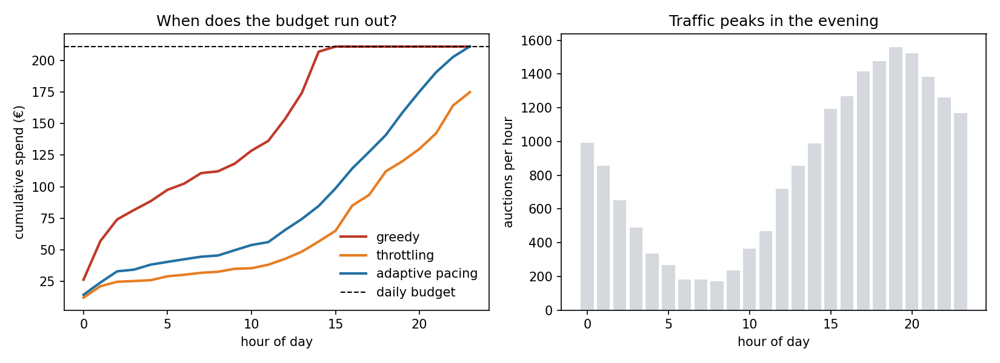
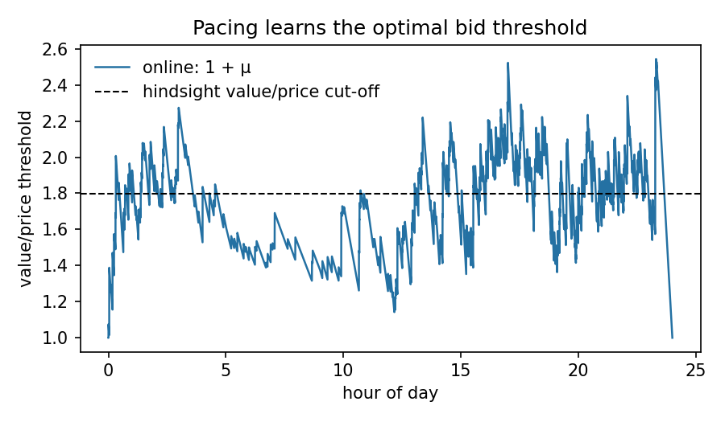
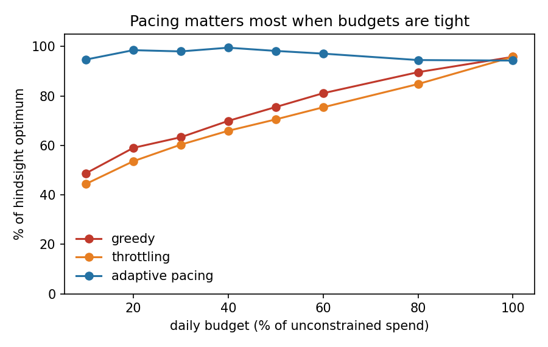
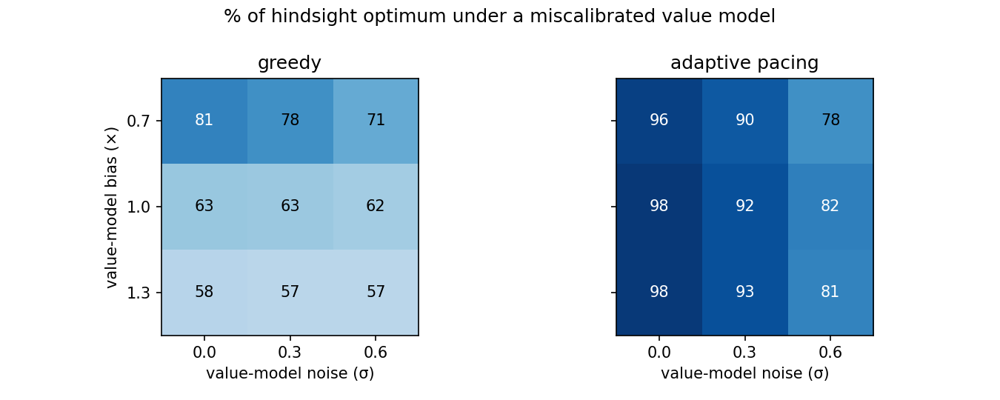

# Budget pacing for search-ad auctions

An advertiser buys clicks in thousands of search-ad auctions a day with a fixed
daily budget. Spend too fast and the budget is gone before the evening peak,
when users convert best. Spend too cautiously and money is left on the table.

This repo simulates one day of second-price ad auctions and compares three ways
of spending a budget against the **best possible outcome in hindsight**.



## Headline result

Daily budget = 30% of what an unconstrained bidder would spend; 20 held-out test
days; mean ± standard deviation.

| Strategy | % of hindsight optimum | Budget used | Value per € spent | Budget runs out |
|---|---|---|---|---|
| Greedy (bid true value until broke) | 63.6 ± 3.0 | 100.0% | 1.70 | 14:00 (median) |
| Throttling (bid in a random 30% of auctions) | 60.8 ± 5.5 | 93.6% | 1.74 | never (most days) |
| **Adaptive pacing** (dual descent) | **97.4 ± 4.2** | 99.9% | **2.60** | 23:00 (median) |

Adaptive pacing gets **53% more value from the same budget** than greedy
bidding (2.60 vs 1.70 per euro), and is within 3% of what a bidder with
perfect knowledge of every future auction could achieve.

## The model

**Market** (`src/adpacing/market.py`). 20,000 auctions per day across 20 keyword
segments, each with its own click-through rate, conversion rate and booking
commission. Traffic and user intent peak in the evening; competitors bid around
the segment's average value and harder at peak hours.

**Auction** (`src/adpacing/auction.py`). Single slot, second price: we win if our
per-click bid beats the highest competing bid, and pay that competing bid when
the user clicks. In a second-price auction, bidding your true value is optimal
*without* a budget. With a budget, it is not.

**Strategies** (`src/adpacing/bidders.py`)

- *Greedy*: bid the value of a click until the budget is gone.
- *Throttling*: bid truthfully in a random fraction `p` of auctions, with `p`
  set on pilot days so that expected spend matches the budget.
- *Adaptive pacing* (Balseiro & Gur, 2019): bid `v / (1 + μ)`, where `μ` is the
  shadow price of the budget. After every auction,
  `μ ← clip(μ − ε · (1 − cost / ρ), 0, μ_max)` with target spend rate `ρ = B / T`:
  spending faster than plan raises `μ` and lowers bids; spending slower does the
  opposite.

**Benchmark** (`src/adpacing/oracle.py`). Knowing every competing bid in advance,
the best allocation is a fractional knapsack: buy auctions in decreasing order of
value-to-price ratio until the budget is spent. No online strategy can beat it
in expectation.

## Why pacing works

In a second-price auction, a bid of `v / (1 + μ)` wins exactly when
`v / price > 1 + μ`. So the pacing bidder is running the hindsight rule online:
*only buy clicks whose value-to-price ratio clears a threshold*. The threshold
is learned from the spend rate alone, with no knowledge of future prices.



`1 + μ` tracks the hindsight cut-off through the day. It falls in the quiet
morning, when the plan is under-spent, and rises through the expensive evening
peak. At the very end of the day the budget is exhausted, bids stop, spend
falls below plan and `μ` decays; that tail does not affect results.

## Findings

**1. Pacing matters most when budgets are tight.** Greedy and throttling only
catch up once the budget stops binding. At 100% of unconstrained spend, pacing
is slightly behind (94.3% vs 95.8%): with a budget that barely binds, its
noisy multiplier occasionally shades bids when it should not.



**2. Pacing absorbs a biased value model, not a noisy one.** If the conversion
model systematically over- or under-estimates values by 30%, the multiplier
rescales bids and pacing still reaches 96–98% of the optimum. Random,
per-auction error is different: it scrambles *which* clicks look cheap, and at
σ = 0.6 pacing drops to 78–82%. Under a binding budget, the value model's
*ranking* quality matters more than its calibration.

Greedy looks *better* with a model that under-estimates values (81% at 0.7×)
only because under-bidding is an accidental form of pacing.



**3. Step size.** Chosen on 5 pilot days, never on test days: ε = 0.002
(98.4% of optimum on pilot days). The method is robust from 0.0005 to 0.005
(95–98%) and degrades when steps are too large (81% at ε = 0.02).

## Evaluation protocol

- Parameters (step size, throttling rate, budget level) are set on **pilot days
  (seeds 0–4)**; every reported number comes from **test days (seeds 100–119)**.
- The budget is a fixed euro amount, not re-scaled to each test day.
- Clicks are random; value is reported in expectation over clicks (CTR × value
  of each auction won), which lowers variance without changing rankings.
- Tests (`tests/`) check the auction rule, that no strategy ever overspends, that
  no strategy beats the hindsight optimum, and that pacing reduces to greedy when
  the budget does not bind.

## Run it

```bash
pip install -r requirements.txt
python experiments/run_all.py   # all tables and figures, ~30 s
pytest -q                       # 12 tests
```

Raw per-run results are in `results/`.

## Limitations and next steps

- **Competitors do not react.** Real bidders pace too, which shifts prices;
  Balseiro & Gur analyse the equilibrium when everyone paces.
- **Single slot, second price.** Search pages have several slots priced by a
  generalised second-price auction with quality scores (Edelman, Ostrovsky &
  Schwarz, 2007), and many ad exchanges now run first-price auctions, where the
  bidder must also shade bids.
- **Values are simulated.** The next step is to learn the value model from data
  (a conversion-rate model) and measure how its ranking quality feeds through to
  spend efficiency, as finding 2 suggests.
- **Budget only.** Advertisers often also target a return on ad spend; that
  adds a second constraint and a second multiplier.

## References

- Vickrey (1961). *Counterspeculation, Auctions, and Competitive Sealed Tenders.* Journal of Finance.
- Edelman, Ostrovsky & Schwarz (2007). *Internet Advertising and the Generalized Second-Price Auction.* American Economic Review.
- Balseiro & Gur (2019). *Learning in Repeated Auctions with Budgets: Regret Minimization and Equilibrium.* Management Science.
- Bernardi, Mavridis & Estevez (2019). *150 Successful Machine Learning Models: 6 Lessons Learned at Booking.com.* KDD.
